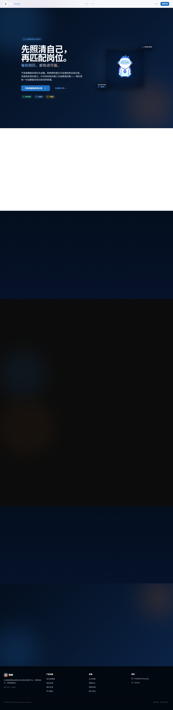

# 职映 · ZhiYing

**从真实经历出发，整理自己的能力与求职方向。** 项目围绕知识库、个人画像、岗位匹配和简历预览构建求职工作流；“待补强”信息应与已验证经历分开呈现，不把示例简历当成用户真实履历。

[在线项目导览](https://yangwei251003.github.io/zhiying/) · [MIT](LICENSE) · [第三方说明](THIRD_PARTY_NOTICES.md)



## 当前状态

开发中的 Next.js 全栈项目。Pages 提供静态项目导览、真实截图和源码运行入口。完整的认证、知识库、模型生成与数据库写入，需要自行部署服务并配置 Supabase/智谱接口；Pages 无法运行这些后端。

源码中存在演示画像和简历示例。是否已接入真实账号/模型必须看各页面和接口实际实现，不能由界面上的样例推断功能已完成。

## 技术与功能

- Next.js 15 / React19 / TypeScript，Tailwind CSS **3**、Radix/shadcn风格组件、Framer Motion。
- Supabase Auth/Postgres/Storage；服务端接口组织知识库、分析与匹配功能。
- 智谱模型调用和 DOCX 简历导出相关实现。模型使用者自行配置，不随开源源码提供密钥。
- 求职说明、页面规范、架构和开发计划保留于 `docs/`，是设计和实现参考，不替代测试报告。

## 快速开始

准备 Node.js24 LTS、npm；完整功能另需你自己的 Supabase 项目和模型服务权限。

```bash
git clone https://github.com/yangwei251003/zhiying.git
cd zhiying
npm ci
```

1. 将 `.env.example` 复制为 `.env.local`：PowerShell 使用 `Copy-Item .env.example .env.local`，macOS/Linux 使用 `cp .env.example .env.local`。
2. 在自己的 Supabase 测试项目执行 `supabase/migration.sql`；先审阅 SQL 与权限设置。
3. 填写 `NEXT_PUBLIC_SUPABASE_URL`、`NEXT_PUBLIC_SUPABASE_ANON_KEY`、仅服务端使用的 `SUPABASE_SERVICE_ROLE_KEY`，以及 `ZHIPU_API_KEY`；可按需配置端点、模型和 `NEXT_PUBLIC_APP_URL`。
4. 不配置 Supabase 时可以打开公开介绍页；API 明确返回 503“未配置”，不能把介绍页打开当作完整后端可用。

```bash
npm run dev
# 打开 http://localhost:3000

# 生产运行
npm run build
npm start
```

部署到支持 Next.js 服务端的 Node 环境或平台，并在其环境设置中填写密钥；不将 `.env.local`、真实简历、数据库内容、令牌或部署凭证提交到仓库。现有部署工作流引用 GitHub Secrets，使用前自行配置目标服务权限。

## 目录

```text
src/app/        页面与服务端 API
src/components/ 界面组件
src/lib/        数据库、模型与工具
src/middleware.ts 认证与未配置服务的明确响应
supabase/       数据库迁移
docs/           需求、设计、架构与开发记录
docs/site/      静态导览与本轮真实截图
```

## 本轮验证与后续

2026-10-26：正常安装依赖，补充安全环境模板与许可证；修复未配置数据库时公开介绍页无法打开的问题，服务 API 保持明确不可用；将元数据地址改为使用者自己的应用 URL。Next.js 同主版本更新到 15.5.28，PostCSS 和其他可修补依赖同步更新。

生产构建包含的类型检查通过。实际 Chrome 访问公开首页返回200，桌面与390px手机截图、页面异常/同源请求检查通过；未登录账号，未连接模型、私人数据库或支付。仓库没有声明单元测试命令，不编造测试数量。下一步应补知识库、权限与生成结果可追溯性的集成测试，再验证完整部署。

本仓库与本地另一个同名 React/Vite 网页结构不同，本轮没有将其互相覆盖。素材与依赖许可见第三方说明。


## 可选数据库迁移

迁移脚本只在显式追加 `--apply` 后连接并修改数据库。先为自己的开发数据库在私有环境中设置 `DATABASE_URL`，安装依赖，再运行 `node scripts/migrate.mjs --apply`。默认验证TLS证书；无参数或 `--help` 只显示说明，不连接。不要把真实数据库密码、账户、主机配置或连接串写入源码。

2026-10-26：移除旧迁移脚本的硬编码数据库配置；SQL结构保持不变。旧配置不得作为示例使用，曾有效的密码应在服务商轮换。

## 可选Vercel后端部署

GitHub Pages只发布静态项目导览，完整Next.js服务和模型接口并未因此上线。旧Vercel工作流在未配置账号时失败；现默认跳过，只有仓库变量`ENABLE_VERCEL_DEPLOY=true`并手动执行该工作流才启用。

如需自行部署，在仓库变量配置`VERCEL_ORG_ID`、`VERCEL_PROJECT_ID`、`ZHIPU_BASE_URL`和`ZHIPU_MODEL`，私密`VERCEL_TOKEN`及`ZHIPU_API_KEY`仅放GitHub Secrets。工作流先检查名称是否齐全，不打印值；不要把账号、令牌或私有配置写入源码。模型名称和服务可用性以你自己的服务商权益为准。

本次只修复未授权/未配置时的执行条件并移除硬编码部署目标；没有登录Vercel、创建云端项目、调用模型或验证真实后端部署。历史失败仍保留为真实记录，默认跳过不等同部署成功。数据库迁移继续只在显式`--apply`时读取私有`DATABASE_URL`，既有凭据守卫保持。
